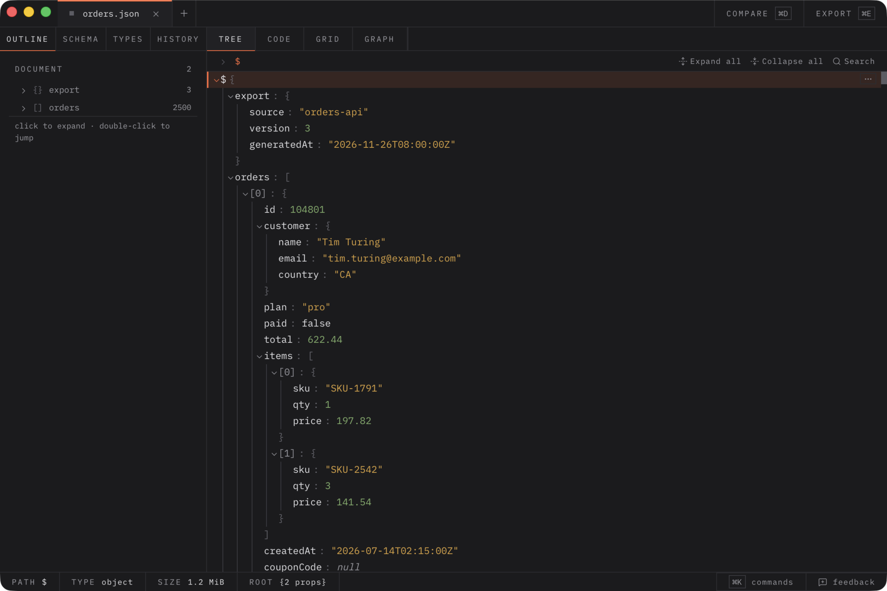
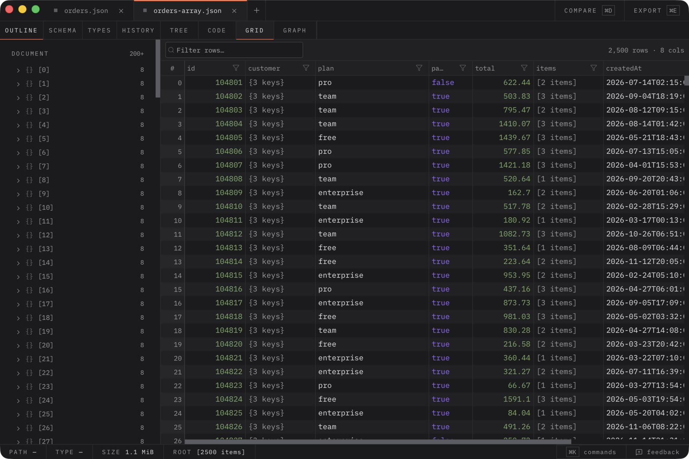
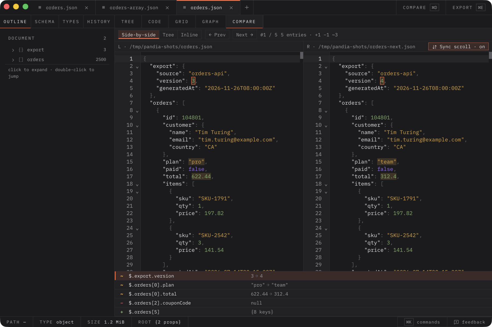

<p align="center">
  
</p>

<h1 align="center">Pandia</h1>

<p align="center">
  A desktop app for reading, editing and checking JSON, from small config files to exports of several gigabytes.
</p>

<p align="center">
  <a href="https://github.com/hendurhance/pandia/releases/latest"></a>
  <a href="LICENSE"></a>
  <a href="https://github.com/hendurhance/pandia/releases"></a>
  <a href="https://github.com/sponsors/hendurhance"></a>
</p>

<p align="center">
  <a href="https://www.pandia.app">Website</a> ·
  <a href="#install">Install</a> ·
  <a href="https://www.pandia.app/docs">Docs</a> ·
  <a href="#build-from-source">Build from source</a> ·
  <a href="https://github.com/hendurhance/pandia/issues/new/choose">Report an issue</a>
</p>

<p align="center">
  
</p>

## Why Pandia

Text editors and browser tools slow down or give up once a JSON file passes a few hundred megabytes, and online formatters ask you to paste your data into someone else's website. Pandia keeps the document in a Rust engine on your own computer and only sends the part you're looking at to the screen, so a large file stays responsive while you scroll, search and edit it. It works offline, needs no account, and collects no usage data.

## What you can do with it

### Read the same document five ways

| View | Use it to |
|---|---|
| **Tree** | Expand, edit and reorder values, with the path of the selected value always on screen |
| **Code** | Read and edit the raw text, with syntax highlighting, folding and find and replace |
| **Grid** | Treat an array of objects as a spreadsheet: sort, filter, select rows and edit cells |
| **Graph** | See the structure as connected nodes, and export it as PNG, JPEG or SVG |
| **Compare** | Diff two files or tabs side by side, inline, or as a highlighted tree |

<p align="center">
  
  
</p>

### Open what you have

- Open `.json`, `.jsonc`, `.json5`, `.jsonl`, `.ndjson` and `.geojson` files. YAML, XML and CSV are converted to JSON when you open them.
- Paste text, drop a file, or fetch a URL. Paste a cURL command to send the request and open the response.
- Open broken JSON anyway. Trailing commas, comments, single quotes and unquoted keys are repaired on open, and Pandia tells you what it changed.
- Keep every digit of large numbers, such as 64-bit IDs and nanosecond timestamps.

### Check and convert

- Validate against a JSON Schema (draft-07 or 2020-12). Pandia picks up a schema from `--schema` on the command line or from the document's `$schema` field.
- Generate types in 10 languages: TypeScript, Zod, Go, Rust, Kotlin, Python, PHP, Java, Dart and JSON Schema. A field is marked optional when some records leave it out.
- Export to JSON, minified JSON, YAML, CSV or XML.

### Work from the terminal

Install the `pandia` command from **Settings → Behavior**. Homebrew installs it for you.

```bash
pandia data.json                         # open a file in the running window
curl -s https://api.example.com | pandia -   # open whatever is piped in
pandia --diff old.json new.json          # open two files in Compare
pandia --wait - < draft.json > out.json  # edit piped JSON, save to send it back
```

`--wait` makes Pandia a review step for scripts and AI coding agents: the command waits until you close the tab, and exits with `1` if the Schema panel shows errors. Add `--json` for a machine-readable report.

A set of commands answers without opening a window: `get`, `shape`, `validate`, `diff`, `search`, `types`, `convert` and `repair`. Run `pandia <command> --help` for details.

```bash
pandia get orders.json '$.orders[0].customer.email'
pandia validate config.json --schema config.schema.json
```

## Large files

How Pandia handles a file depends on its size.

| Size | What works |
|---|---|
| Up to 10 MB | Everything |
| 10 MB to 200 MB | Everything. The Code view is available up to 50 MB. |
| 200 MB to 2 GB | Browse, search, Grid sort and filter, the Graph, type generation and JSON export. Editing, schema validation and Compare are turned off. |
| 2 GB to 10 GB | A read-only view, read straight from disk so the file doesn't have to fit in memory. You can browse it in the Tree and Grid and search it, with progress and a Cancel button. |
| Over 10 GB | Not supported. Pandia tells you the file is over the limit. |

On a 5 GB file, opening takes under a minute and a full search about half a minute, depending on your disk.

## Install

Download Pandia for your platform from the [latest release](https://github.com/hendurhance/pandia/releases/latest).

| Platform | Download |
|---|---|
| macOS, Apple silicon | [`Pandia_1.0.9_aarch64.dmg`](https://github.com/hendurhance/pandia/releases/latest/download/Pandia_1.0.9_aarch64.dmg) |
| macOS, Intel | [`Pandia_1.0.9_x64.dmg`](https://github.com/hendurhance/pandia/releases/latest/download/Pandia_1.0.9_x64.dmg) |
| Windows, installer | [`Pandia_1.0.9_x64-setup.exe`](https://github.com/hendurhance/pandia/releases/latest/download/Pandia_1.0.9_x64-setup.exe) |
| Windows, MSI | [`Pandia_1.0.9_x64_en-US.msi`](https://github.com/hendurhance/pandia/releases/latest/download/Pandia_1.0.9_x64_en-US.msi) |
| Linux, AppImage | [`Pandia_1.0.9_amd64.AppImage`](https://github.com/hendurhance/pandia/releases/latest/download/Pandia_1.0.9_amd64.AppImage) |
| Linux, Debian and Ubuntu | [`Pandia_1.0.9_amd64.deb`](https://github.com/hendurhance/pandia/releases/latest/download/Pandia_1.0.9_amd64.deb) |
| Linux, Fedora and RHEL | [`Pandia-1.0.9-1.x86_64.rpm`](https://github.com/hendurhance/pandia/releases/latest/download/Pandia-1.0.9-1.x86_64.rpm) |

The macOS app is signed and notarized.

On macOS you can also use [Homebrew](https://brew.sh):

```bash
brew tap hendurhance/tap
brew install --cask pandia
```

Pandia runs on macOS 10.15 or later, 64-bit Windows 10 or later, and Linux with glibc 2.35 or later and WebKitGTK 4.1 (for example Ubuntu 22.04 or Fedora 38).

## Getting started

1. Open Pandia.
2. Drop a JSON file onto the window, or paste JSON into the empty tab.
3. Switch views with `⌘1` to `⌘4` (Tree, Code, Grid, Graph).
4. Press `⌘K` to open the command palette. Every action is listed there.

### Keyboard shortcuts

On Windows and Linux, use `Ctrl` instead of `⌘`.

| Shortcut | Action |
|---|---|
| `⌘K` | Command palette |
| `⌘O` | Open a file |
| `⌘T` / `⌘W` | New tab / close tab |
| `⌘⇧]` / `⌘⇧[` | Next tab / previous tab |
| `⌘F` | Find |
| `⌘G` / `⌘⇧G` | Next match / previous match |
| `⌘⌥F` | Find and replace (`Ctrl+H` on Windows and Linux) |
| `⌘D` | Compare with another tab or file |
| `⌘S` / `⌘⇧S` | Save / save as |
| `⌘E` | Export |
| `⌘Z` / `⌘⇧Z` | Undo / redo |
| `⌘1` to `⌘4` | Tree, Code, Grid, Graph |
| `⌘⇧V` | Open the Schema panel |
| `⌘B` | Show or hide the sidebar |
| `⌘/` | All keyboard shortcuts |
| `⌘,` | Settings |

## How it works

Each open document lives in Rust, and the interface asks for the slice it needs to draw. Rust owns the parsed document and everything that changes or reads it as a whole: edits, undo and redo, search, diff, repair, validation, type generation and export. The Svelte interface owns what you're looking at: the selection, which rows are expanded, scroll positions, and layout.

Files of 10 MB and up open without being parsed into a full tree. Pandia indexes where each item starts and decodes only the items on screen. Files over 2 GB are memory-mapped, so the operating system reads the parts you open from disk instead of loading the whole file.

| Layer | Technology |
|---|---|
| Interface | [Svelte 5](https://svelte.dev), [SvelteKit](https://kit.svelte.dev), TypeScript |
| App shell | [Tauri 2](https://tauri.app), [Rust](https://www.rust-lang.org) |
| JSON parsing | [`sonic-rs`](https://github.com/cloudwego/sonic-rs) for large files, [`serde_json`](https://github.com/serde-rs/json) otherwise |
| Code view | [CodeMirror 6](https://codemirror.net) |
| Schema validation | [`jsonschema`](https://crates.io/crates/jsonschema) |
| Website and docs | [Astro](https://astro.build) |

## Build from source

You need [Node.js](https://nodejs.org) (LTS), [Rust](https://www.rust-lang.org/tools/install) (stable), and the [Tauri system prerequisites](https://tauri.app/start/prerequisites/) for your platform.

<details>
<summary>Platform setup</summary>

**macOS**

```bash
xcode-select --install
```

**Windows**: install the [Visual Studio Build Tools](https://visualstudio.microsoft.com/visual-cpp-build-tools/) with the "C++ build tools" workload. WebView2 comes with Windows 11.

**Ubuntu or Debian**

```bash
sudo apt update
sudo apt install -y libwebkit2gtk-4.1-dev libappindicator3-dev librsvg2-dev patchelf \
  build-essential curl wget file libssl-dev libgtk-3-dev
```

</details>

```bash
git clone https://github.com/hendurhance/pandia
cd pandia
npm ci

npm run tauri dev                                                # development build with hot reload
npm run tauri build -- --config src-tauri/tauri.prod.conf.json   # release build
```

Before you open a pull request, run the same checks CI runs:

```bash
npm run check && npm run lint && npm run format:check && npm run test
cd src-tauri && cargo fmt --check && cargo clippy --all-targets && cargo test --lib
```

### Where to start reading

```
src/                       Svelte interface
  lib/docpane/             the editor inside each tab
  lib/views/               Tree, Code, Grid, Graph and Compare
  lib/shell/               window, tabs, menus and status bar
  lib/ipc/                 generated, typed bindings to the Rust commands
src-tauri/src/
  doc/                     the document engine: parsing, edits, search, export
  commands.rs              the commands the interface can call
  cli.rs, headless.rs      the pandia command
website/                   pandia.app (a separate Astro project)
```

Good first files are `src-tauri/src/doc/document.rs` for the document model, `src-tauri/src/doc/tier.rs` for the size limits, and `src/lib/docpane/components/DocPane.svelte` for the editor.

## Contributing

Bug reports and pull requests are welcome. For a larger change, open an issue first so we can agree on the approach. The full guide is in [CONTRIBUTING.md](CONTRIBUTING.md).

## Support the project

Pandia is free, with no paid tier. If it saves you time, you can support its development through [GitHub Sponsors](https://github.com/sponsors/hendurhance) or [Buy Me a Coffee](https://buymeacoffee.com/hendurhance). A star, a clear [bug report](https://github.com/hendurhance/pandia/issues/new/choose), or telling a colleague who works with JSON all day helps too.

## Acknowledgments

Pandia is built on [Tauri](https://tauri.app), [Svelte](https://svelte.dev), [`sonic-rs`](https://github.com/cloudwego/sonic-rs), [`serde_json`](https://github.com/serde-rs/json), [`jsonschema`](https://crates.io/crates/jsonschema), [CodeMirror](https://codemirror.net) and [Lucide](https://github.com/lucide-icons/lucide) icons. The tree interactions take after [JSON Editor Online](https://jsoneditoronline.org) and the repair rules after [`jsonrepair`](https://github.com/josdejong/jsonrepair), both by Jos de Jong. The bundled code fonts come from the [Fontsource](https://fontsource.org) project.

## License

Pandia is licensed under the [Apache License 2.0](LICENSE).
